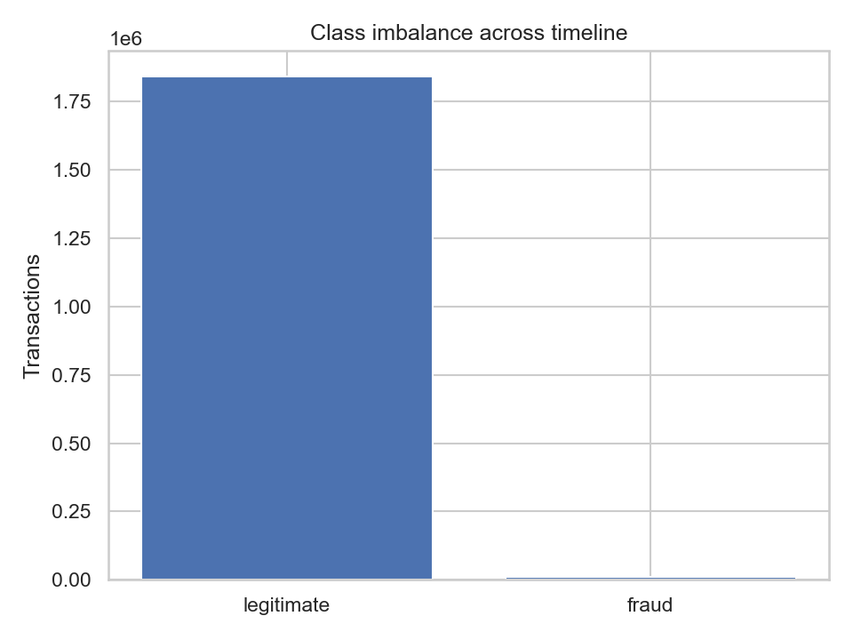
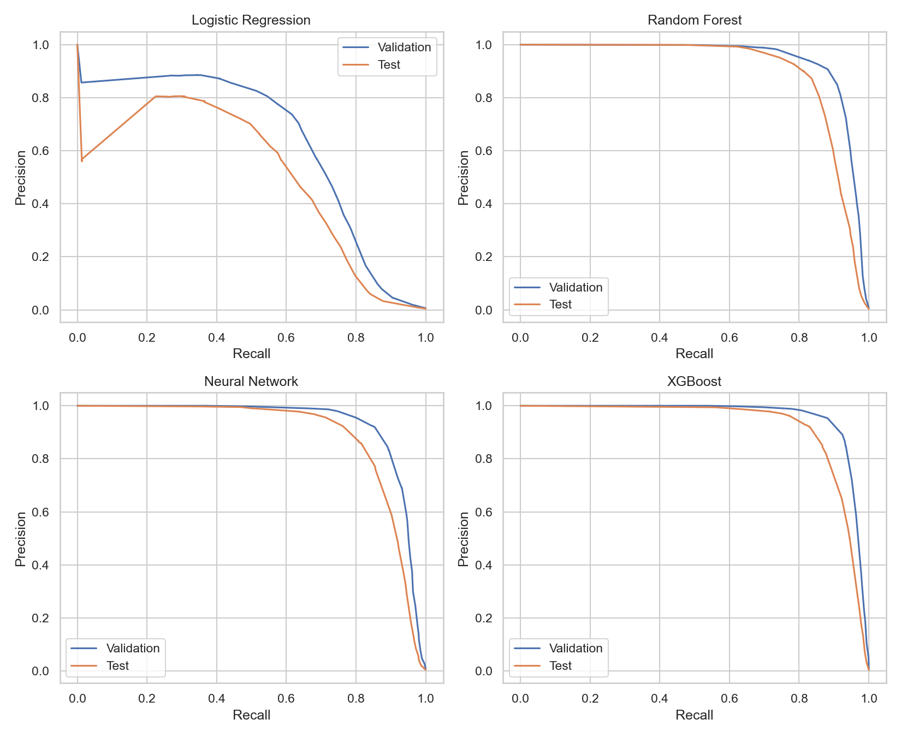
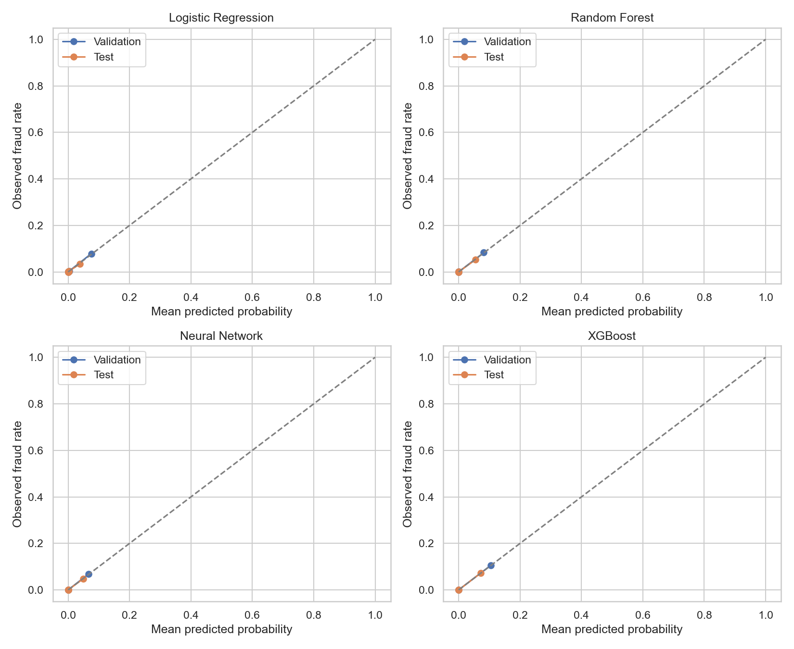
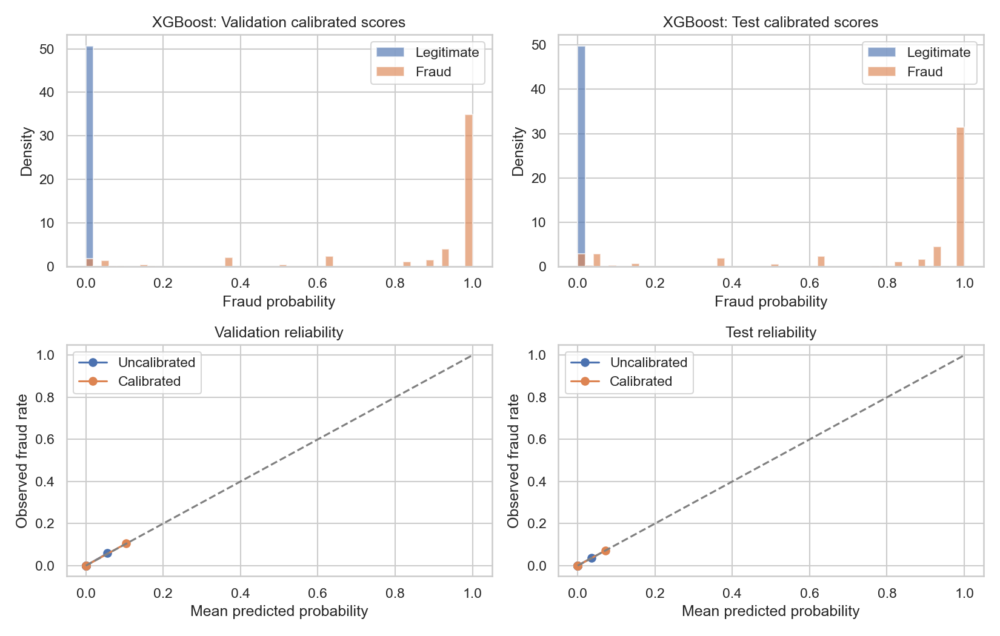
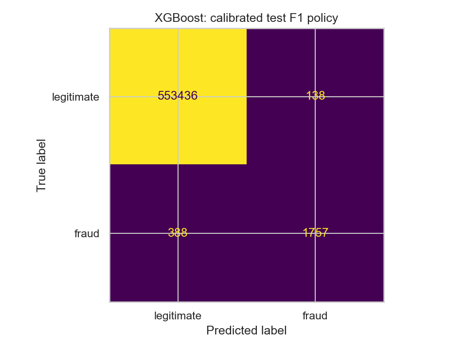
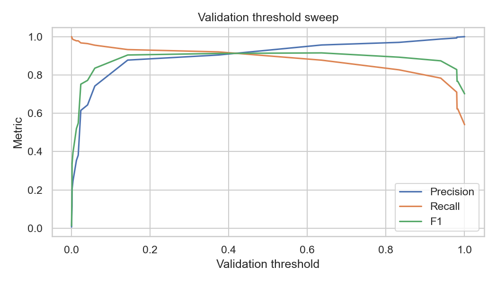
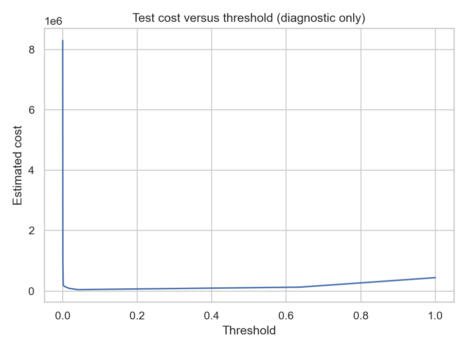
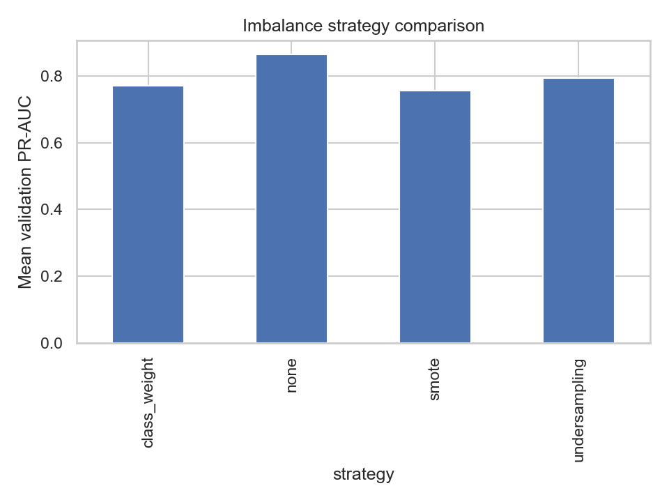

# Card Fraud Detection using Machine Learning

[](https://github.com/Sritzz-3/card-fraud-detection-ml/actions/workflows/ci.yml) [](LICENSE)

This project evaluates chronological credit-card fraud detection using causal card behavior features, time-stratified model search, four imbalance strategies, validation calibration, and validation-only operating thresholds. The run used 1,296,675 training-source rows and 555,719 later test rows from the public Sparkov dataset; the final calibrated XGBoost policy reached 0.927 precision, 0.819 recall, 0.870 F1, and 0.910 PR-AUC on the later test set.

## Data source

The full run used the public **Credit Card Transactions Fraud Detection Dataset** (Sparkov simulation), loaded from `data/raw/fraudTrain.csv` and `data/raw/fraudTest.csv`. This dataset is a simulation of transactions, not actual bank records. The combined timeline contains 1,852,394 rows. The fit, validation, and test partitions contain 1,037,340 rows (0.5753% fraud), 259,335 rows (0.5931%), and 555,719 rows (0.3860%), respectively. The committed 5,000-row `data/sample/transactions_sample.csv` is synthetic and is used only for CI smoke tests; it does not contribute to the full-run results.

## Problem and evaluation

Fraud is rare, so a model that predicts every transaction as legitimate can have high accuracy while catching no fraud. The project reports average precision (PR-AUC), precision, recall, and F1, with ROC-AUC as a secondary reference. The Kaggle train file is split chronologically: its earliest 80% is used for fitting and its latest 20% for validation. The later Kaggle test file remains the final holdout. Thresholds and the final operating policy are chosen using validation only.

## Method

```mermaid
flowchart LR
  A[fraudTrain and fraudTest] --> B[Concatenate chronological card history]
  B --> C[Causal past-only features]
  C --> D[Time split: train / validation / final test]
  D --> E[Time-stratified parameter search]
  E --> F[None / weights / undersampling / SMOTE]
  F --> G[First-half validation calibration]
  G --> H[Second-half validation thresholds]
  H --> I[One-time later-test evaluation and diagnostics]
```



### Behavioral features

| Group | Example features | Fraud signal |
|---|---|---|
| Time | Hour, weekday, weekend, night, cyclic hour | Transactions at unusual times |
| Amount history | Log amount, prior expanding mean and standard deviation, amount z-score, prior max ratio | Spend departing from the card's previous pattern |
| Velocity | Previous transaction counts over 1h, 6h, 24h and 7d; prior amount totals; seconds since previous | Rapid transaction bursts |
| Geography | Home-to-merchant distance, previous merchant distance, implied speed | Unexpected distance or travel |
| Novelty | New merchant/category, card's prior category share and frequency | Activity outside established history |
| Demographic | Age, log city population, gender, job frequency | Context around cardholder transactions |

All records from train, validation, and test are concatenated before feature generation, then sorted by card and timestamp. Expanding statistics are shifted, and time-window aggregates are left-closed, so each transaction sees only earlier events for that card. Categorical frequencies are computed in chronological order without labels. Card numbers, merchant names, raw timestamps, names, address text, transaction IDs, and raw coordinates are excluded from model inputs. Unit tests check rolling counts, haversine distance, future-row invariance, and chronological partition boundaries.

### Model search and imbalance

The pipeline searches two configured candidate settings per model on a chronological, label-stratified training subsample, then compares none, class weights/`scale_pos_weight`, random undersampling, and SMOTE on training-only data. The Neural Network omits class weights because `MLPClassifier` does not support them. Search, fit, SMOTE, and undersampling limits are configurable in `config.yaml`. Validation PR-AUC selected `none` for every model: Logistic Regression 0.633, Random Forest 0.938, Neural Network 0.931, and XGBoost 0.957. The full strategy comparison is in `outputs/tables/imbalance_comparison.csv`.

## Test results

The values below are from `outputs/tables/model_comparison.csv`. Each row uses that model's calibrated validation F1-maximizing threshold, selected on the second chronological half of validation. PR-AUC is computed from the calibrated scores on the final test partition.

| Model | Precision | Recall | F1 | PR-AUC |
|---|---:|---:|---:|---:|
| Logistic Regression | 0.622 | 0.551 | 0.584 | 0.517 |
| Random Forest | 0.873 | 0.836 | 0.854 | 0.889 |
| Neural Network | 0.868 | 0.807 | 0.836 | 0.880 |
| XGBoost | 0.927 | 0.819 | 0.870 | 0.910 |

### Calibration and operating policy

Isotonic and Platt calibration models were fit on the first chronological half of validation; the lower second-half validation log loss selected the calibrator. Isotonic won for all four models. For the selected XGBoost model, the calibrated validation log loss was 0.00367. The final policy is **maximize F1 on calibrated scores**, with threshold 0.636364 selected on the second validation half. The threshold is applied unchanged to the later test data. Calibration comparison and every calibrated/uncalibrated policy result are recorded in `calibration_comparison.csv` and `policy_comparison.csv`.

| XGBoost F1 policy | Test precision | Test recall | Test F1 | Test PR-AUC |
|---|---:|---:|---:|---:|
| Uncalibrated | 0.912 | 0.835 | 0.872 | 0.923 |
| Calibrated (selected) | 0.927 | 0.819 | 0.870 | 0.910 |

| XGBoost policy (calibrated) | Test precision | Test recall | Test F1 |
|---|---:|---:|---:|
| F1 maximum (final policy) | 0.927 | 0.819 | 0.870 |
| Precision target ≥ 0.90 with ≥30 validation true positives | 0.851 | 0.867 | 0.859 |
| Review capacity: top 0.25% of validation scores | 0.995 | 0.476 | 0.644 |
| Review capacity: top 0.50% of validation scores | 0.978 | 0.719 | 0.829 |
| Review capacity: top 1.00% of validation scores | 0.503 | 0.945 | 0.657 |

The review-capacity policies define queue size by the share of validation transactions flagged; their thresholds are then fixed when applied to test. The precision-constrained policy is selected on validation and therefore does not guarantee the same precision on test. Its test precision is 0.851. The final F1 policy test confusion matrix is TN=553,436, FP=138, FN=388, TP=1,757. The 200-resample bootstrap 95% intervals are 0.916–0.937 for precision and 0.804–0.836 for recall (`outputs/tables/bootstrap_ci.csv`).

### Cost and slices

With missed fraud costed at the transaction amount and a fixed $15 review cost per false alarm, the final test policy costs $126,712.03: $124,642.03 in missed-fraud amount and $2,070.00 in false-alarm review cost across 138 false alarms. This is a configurable scenario assumption, not a measured operating cost; the breakdown and threshold curve are in `cost_summary.csv` and `cost_curve.csv`. By amount quartile, the highest quartile contains 1,460 of 1,757 true positives; grocery point-of-sale and online shopping categories have the largest true-positive counts (474 and 466). Full slice results are in `slice_analysis.csv`.

Permutation importance on a validation sample ranks amount (0.463), causal category frequency (0.283), and prior 24-hour amount (0.248) highest. XGBoost gain ranks prior expanding amount mean (0.100), seconds since the previous transaction (0.098), and new-category status (0.092) highest. The two measures emphasize different aspects of the fitted model; both are saved in `feature_importance.csv`. These values are specific to this simulated dataset and should not be generalized to real bank traffic.

## Interpreting the results

The selected calibrated F1 threshold is 0.636, with validation precision 0.957 and recall 0.877. At that unchanged threshold, the later test file has precision 0.927 and recall 0.819; it flags 1,757 of 2,145 frauds. The calibrated fraud-score median is 1.000 on validation and 0.983 on test, while the 10th percentile shifts from 0.373 to 0.059, showing a lower-scored test tail. Calibration increases test precision from 0.912 to 0.927 while recall moves from 0.835 to 0.819; both threshold-specific results are reported in `policy_comparison.csv`. This one simulated chronological holdout cannot establish how these results transfer to actual bank traffic.

## Figures


















## Run it

Python 3.11, seed 42, and a measured 260.8-second full run were used for the reported outputs (environment setup excluded). Put the Kaggle files at `data/raw/fraudTrain.csv` and `data/raw/fraudTest.csv`, install pinned dependencies, then run:

```bash
make setup
make test
.venv/bin/python -m src.run_pipeline --seed 42
```

For the 5,000-row synthetic CI smoke path:

```bash
.venv/bin/python -m src.run_pipeline --sample --seed 42
```

If either public dataset file is absent, the pipeline falls back to synthetic transactions and records that source in `run_summary.csv`. Raw files and fitted model binaries are Git-ignored.

## Repository structure

```text
card-fraud-detection-ml/
├── .github/
│   └── workflows/ci.yml
├── .gitignore
├── LICENSE
├── Makefile
├── README.md
├── config.yaml
├── data/
│   ├── processed/.gitkeep
│   ├── raw/.gitkeep
│   └── sample/transactions_sample.csv
├── notebooks/
│   └── 01_walkthrough.ipynb
├── outputs/
│   ├── figures/
│   │   ├── class_imbalance.png
│   │   ├── confusion_matrix.png
│   │   ├── cost_curve.png
│   │   ├── feature_importance.png
│   │   ├── imbalance_comparison.png
│   │   ├── precision_recall.png
│   │   ├── reliability_curves.png
│   │   ├── score_distributions.png
│   │   ├── threshold_sweep.png
│   │   └── validation_test_pr_curves.png
│   ├── models/.gitkeep
│   └── tables/
│       ├── bootstrap_ci.csv
│       ├── calibration_comparison.csv
│       ├── cost_curve.csv
│       ├── cost_summary.csv
│       ├── feature_importance.csv
│       ├── imbalance_comparison.csv
│       ├── model_comparison.csv
│       ├── policy_comparison.csv
│       ├── run_summary.csv
│       ├── slice_analysis.csv
│       ├── threshold_diagnostics.csv
│       ├── threshold_sweep.csv
│       ├── thresholds.csv
│       └── tuning_results.csv
├── requirements.txt
├── src/
│   ├── __init__.py
│   ├── config.py
│   ├── data_generator.py
│   ├── data_loader.py
│   ├── diagnostics.py
│   ├── evaluation.py
│   ├── explain.py
│   ├── features.py
│   ├── imbalance.py
│   ├── models.py
│   ├── run_pipeline.py
│   ├── splits.py
│   └── visualization.py
└── tests/
    ├── __init__.py
    ├── test_evaluation.py
    ├── test_features.py
    ├── test_pipeline_smoke.py
    └── test_splits.py
```

## Limitations

The Sparkov dataset is simulated transaction data, not records from actual banks or cardholders. Reported performance comes from one time-based train/validation/test split. The review cost is an assumed fixed amount, and calibration or precision may shift with future transaction distributions. Validate on independently sourced data and recalibrate costs before applying the approach operationally.
