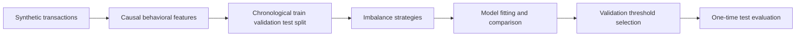
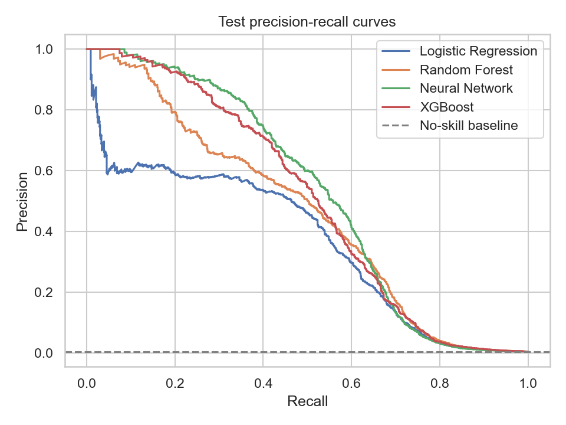
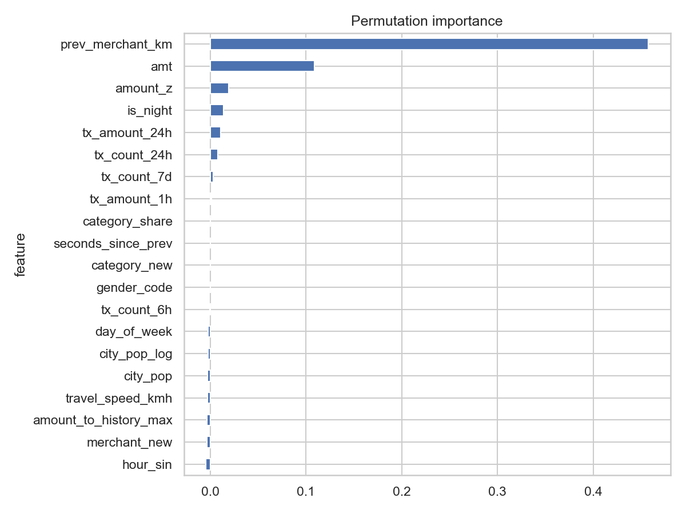

# Card Fraud Detection using Machine Learning

[](https://github.com/Sritzz-3/card-fraud-detection-ml/actions/workflows/ci.yml) [](LICENSE)

This project builds a reproducible fraud classification workflow with causal card behavior features, a chronological holdout, threshold selection, and imbalance-aware model comparisons. The default seeded generator produced 1,000,000 transactions across 1,500 synthetic cards with a 0.4942% fraud rate. Validation selected an MLP Neural Network; on the final time-ordered test set it achieved 1.000 precision, 0.001 recall, 0.002 F1, and 0.523 PR-AUC at the configured precision-constrained threshold.

## Data source

The data is **synthetic**, generated locally by `src/data_generator.py`; no Kaggle download was attempted. The generator simulates transaction-level patterns for testing the workflow. The reported metrics describe only this synthetic sample and must not be interpreted as evidence about real card fraud.

## Problem and evaluation

Fraud is rare, so a model that predicts every transaction as legitimate can achieve very high accuracy while catching no fraud. This project emphasizes average precision (PR-AUC), precision, recall, and F1, with ROC-AUC as a secondary reference. Thresholds are selected on validation data and then held fixed for the later test partition.

## Method



### Behavioral feature groups

| Group | Example features | Fraud signal |
|---|---|---|
| Time | Hour, weekday, weekend, night, cyclic hour | Unusual transaction timing |
| Amount history | Log amount, expanding mean and standard deviation, amount z-score | Spending that departs from prior card behavior |
| Velocity | Prior transaction counts over 1h, 6h, 24h and 7d; prior amount; seconds since prior | Rapid activity bursts |
| Geography | Home to merchant distance, previous merchant distance, implied speed | Unexpected travel or distant purchases |
| Novelty | New merchant/category flags, category share | Purchases outside established behavior |
| Demographic | Age, log city population, gender code, job/category frequency | Contextual transaction patterns |

Feature generation sorts by card and event time. Expanding statistics and rolling windows are shifted or left-closed so a transaction cannot use its own label or any later transaction. Identifiers, merchant/card IDs, raw timestamps, and raw location coordinates are excluded from model inputs. The evaluation partitions themselves are chronological and disjoint.

## Results from the full synthetic run

These values come from `outputs/tables/model_comparison.csv` and `outputs/tables/run_summary.csv`. The final test partition has 200,000 rows and 994 frauds.

| Model | Precision | Recall | F1 | PR-AUC |
|---|---:|---:|---:|---:|
| Logistic Regression | 1.000 | 0.004 | 0.008 | 0.366 |
| Random Forest | 0.000 | 0.000 | 0.000 | 0.458 |
| Neural Network | 1.000 | 0.001 | 0.002 | 0.523 |
| XGBoost | 1.000 | 0.002 | 0.004 | 0.502 |

The pipeline selects the model using validation PR-AUC; this run selected the Neural Network. It uses the validation threshold 0.999989 under the policy that maximizes recall subject to precision of at least 0.90. The test confusion matrix is TN=199,006, FP=0, FN=993, TP=1. Bootstrap 95% intervals are [0.000, 1.000] for precision and [0.000, 0.0031] for recall, showing the uncertainty around one detected positive.

The validation strategy comparison in `outputs/tables/imbalance_comparison.csv` compares weighted/baseline fitting, random undersampling, and an unweighted baseline. The unweighted Random Forest has the highest RF validation PR-AUC (0.500), while the Neural Network has the highest validation PR-AUC overall (0.489) and the selected test PR-AUC. The selected operating point favors very high precision and misses nearly all fraud. The single detected fraud falls in the highest amount quartile and the `misc_net` category; these counts are too small to infer robust segment behavior. The cost curve in `outputs/tables/cost_curve.csv` uses missed transaction amount plus a fixed $15 review cost; this is a configurable synthetic assumption, not an audited business cost. Permutation importance for the selected model ranks previous-merchant distance first (0.458), followed by amount (0.109), as shown in `outputs/tables/feature_importance.csv`. These rankings are synthetic-generator artifacts and should not be generalized.

## Figures






## Run it

Python 3.11 was used for the full local run with seed 42 (measured runtime: 369.7 seconds; excludes environment setup). Install the pinned packages in `requirements.txt`, then run:

```bash
make setup
make test
make data
make run
```

For the smaller sample path:

```bash
.venv/bin/python -m src.run_pipeline --sample --seed 42
```

The synthetic source is deterministic for a fixed seed. The current default run generates one million rows locally; raw and processed data and model files are ignored by Git.

## Repository structure

```text
card-fraud-detection-ml/
├── .github/
│   └── workflows/ci.yml
├── .gitignore
├── LICENSE
├── Makefile
├── README.md
├── config.yaml
├── data/
│   ├── processed/.gitkeep
│   ├── raw/.gitkeep
│   └── sample/transactions_sample.csv
├── notebooks/
│   └── 01_walkthrough.ipynb
├── outputs/
│   ├── figures/
│   │   ├── class_imbalance.png
│   │   ├── confusion_matrix.png
│   │   ├── cost_curve.png
│   │   ├── feature_importance.png
│   │   ├── imbalance_comparison.png
│   │   ├── precision_recall.png
│   │   ├── roc_curves.png
│   │   └── threshold_sweep.png
│   ├── models/.gitkeep
│   └── tables/
│       ├── bootstrap_ci.csv
│       ├── cost_curve.csv
│       ├── feature_importance.csv
│       ├── imbalance_comparison.csv
│       ├── model_comparison.csv
│       ├── run_summary.csv
│       ├── slice_analysis.csv
│       └── thresholds.csv
├── requirements.txt
├── src/
│   ├── __init__.py
│   ├── config.py
│   ├── data_generator.py
│   ├── data_loader.py
│   ├── evaluation.py
│   ├── explain.py
│   ├── features.py
│   ├── imbalance.py
│   ├── models.py
│   ├── run_pipeline.py
│   ├── splits.py
│   └── visualization.py
└── tests/
    ├── __init__.py
    ├── test_evaluation.py
    ├── test_features.py
    ├── test_pipeline_smoke.py
    └── test_splits.py
```

## Limitations and next steps

The synthetic records are not a substitute for a representative, consented transaction dataset. The test set contains 994 fraud cases, but only two are detected at the chosen threshold; precision and recall intervals remain broad, and slice findings are sparse. The generator uses simplified distributions and does not model a production authorization system, changing fraud strategies, customer-level interventions, or review capacity. A larger, independently sourced evaluation set and operational cost calibration are necessary before any deployment decision.
